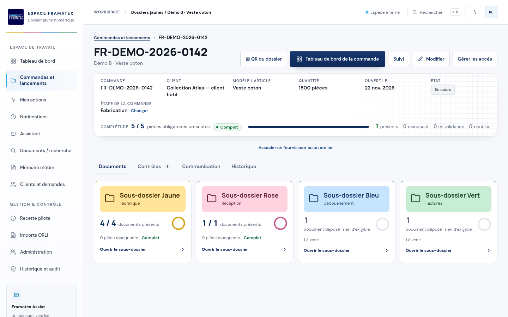

# FRAMATEX — Intelligence documentaire avancée

## État de livraison

Branche : `feat/document-intelligence`, basée sur `feat/smart-business-memory-ux`.

Cette branche livre deux améliorations ciblées à l’intake documentaire :

- lecture PDF hybride, page par page : texte natif conservé et OCR tenté sur les pages sans texte, avec provenance page/méthode/extrait, prétraitement d’image et tentative d’orientation Tesseract;
- comparaison d’une version avec sa version précédente pour les champs structurés persistés et les constats Excel, accessible depuis l’historique documentaire.

La comparaison n’effectue aucune fusion ni modification automatique. Elle est limitée aux résultats structurés déjà extraits et aux constats de formules Excel; ce n’est pas une comparaison sémantique complète du contenu de deux documents.

## Validations exécutées

Les recettes ont été lancées sur le code de révision `096c5887e2e5df841dfe38cb38191462da49acf0` avec un arbre propre :

- Python : `188 passed, 1 warning` (dépréciation Starlette/httpx);
- JavaScript : `node --test tests/*.cjs`, 19 suites réussies;
- recette API/plateforme : `94/94`, dont migration sur copie existante, contrôle d’accès et stabilité runtime;
- recette Chromium complète : `133/133`, dont parcours client A/B, OCR, responsive (1440/1024/820/390 px) et stabilité runtime.

Les captures ci-dessous sont issues de la recette Chromium enregistrée dans `/workspace/artifacts/document-intelligence/browser/captures`.

### Écrans capturés




## Limites restantes

Cette livraison ne couvre pas tout le périmètre d’intelligence documentaire avancée. En particulier, elle n’ajoute pas de rapprochement sémantique des doublons, de recherche plein texte indexée, de comparaison libre/visuelle des PDF, de provenance jusqu’à la cellule pour toutes les extractions, de workflow persistant d’anomalies, ni de surveillance périodique des empreintes. Le score de confiance OCR/extraction n’est pas calibré. L’OCR du PDF hybride est couvert par un test d’intégration synthétique avec OCR contrôlé; la recette globale valide aussi les parcours OCR image déjà existants.

Aucune migration de base n’a été nécessaire pour ces deux fonctions. Les contrôles de recette confirment l’application des migrations sur base vierge et sur copie existante sans perte des données préexistantes. Le traitement reste dans la frontière d’accès FRAMATEX existante; aucun endpoint client n’expose les dossiers internes.

## Reprise Windows (PowerShell)

```powershell
git fetch origin
git switch feat/document-intelligence
if ($LASTEXITCODE -ne 0) { git switch --track origin/feat/document-intelligence }
git pull --ff-only origin feat/document-intelligence
.\scripts\start_windows.cmd
```

La révision de code couverte par les recettes est `096c5887e2e5df841dfe38cb38191462da49acf0`. Le SHA final de publication est fourni dans le compte rendu de livraison après le commit du présent rapport.
