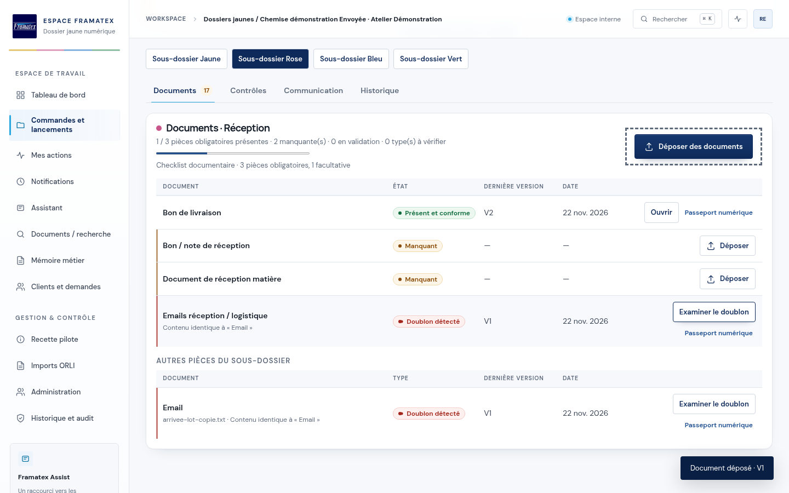
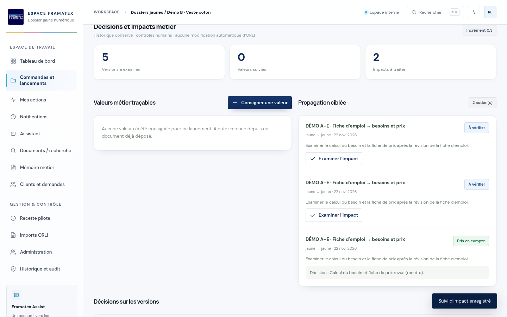
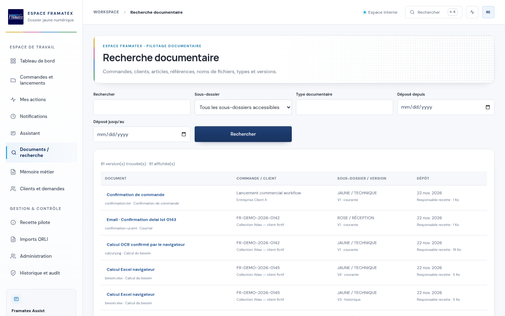

# FRAMATEX — Intelligence documentaire avancée

## Livraison

Branche : `feat/document-intelligence` (aucune modification ni fusion de `main`).

Le parcours livré est : dépôt sécurisé → analyse locale → classification explicable → extraction structurée → proposition de rapprochement → contrôle de cohérence → décision humaine persistante → revérification ciblée. Aucune analyse ne modifie un document, une quantité, un prix ou une décision humaine. La branche `feat/access-management` de Claude Code n'a pas été fusionnée.

Révision fonctionnelle couverte par la recette Chromium finale : `78666136e1da69ad5e084ccfaa8bee3f0cd58f7d`.

## État fonctionnel

| Fonctionnalité | État | Tests et preuves | Limites connues |
|---|---|---|---|
| SHA-256 | Terminée | Doublon binaire détecté malgré un nom différent; passeport d'intégrité existant préservé | Pas de tâche périodique de revérification hors dépôt |
| OCR PDF/image | Terminée dans les limites existantes | PDF texte, hybride, scanné, OCR indisponible; provenance page/méthode/extrait | Analyse bornée (taille/pages); orientation Tesseract sans redressement géométrique avancé |
| Classification | Terminée | Catalogue standard de 22 exigences; cas clair, probable, multiple, incompatible avec le sous-dossier et impossible | Moteur déterministe par contenu, structure et indices; aucune probabilité inventée |
| Extraction structurée | Terminée pour les champs reconnaissables | Références, dates, prix, montant, devise, unités et quantités commandée/produite/livrée distinctes; provenance PDF, Word et Excel | Les mises en page non reconnues restent à confirmer ou sans valeur proposée |
| Excel | Terminée dans le périmètre statique sûr | Feuilles, cellules, en-têtes, valeurs, formules, `#REF!`, unités et différences de versions | Aucune macro, aucun lien externe, aucun recalcul; le cache de calcul n'est pas tenu pour preuve |
| Doublons | Terminée | Exact, potentiel et document indépendant de même type testés | Similarité locale texte/champs; pas de comparaison visuelle perceptuelle des scans |
| Versions | Terminée | Référence compatible + différences; choix explicite de version ou document indépendant | Aucune fusion ni suppression automatique |
| Comparaison | Terminée | Champs proposés/confirmés, références, dates, quantités, prix, unités, formules et texte significatif avant/après | Diff textuel volontairement borné, pas de diff binaire intégral |
| Cohérence | Terminée pour les règles configurées | Sources, versions, valeurs, unités, écart, signature stable et états explicites | Aucune règle métier arbitraire n'est activée; `non applicable` reste un état d'impact, pas une décision de règle chiffrée |
| Décision humaine | Terminée | Accepter avec justification, demander correction, reporter; historique et auteur persistés | Le moteur signale mais ne corrige et ne refuse jamais pour un simple écart métier |
| Alertes | Terminée | Notification interne ciblée sur les règles et sous-dossiers accessibles | Pas de canal e-mail, conformément au périmètre |
| Revérification | Terminée | Une version ou des valeurs sources nouvelles créent une nouvelle signature; une acceptation antérieure n'est pas transférée | Déclenchement limité aux règles configurées concernées |
| Recherche plein texte | Terminée pour les nouvelles analyses | SQLite FTS5, extrait de contenu, index actualisé à la publication, isolation par commande/sous-dossier | La migration ne rétro-indexe pas automatiquement tous les anciens documents |
| Intégration accès Claude | Préparée, non fusionnée | Permissions actuelles vérifiées sur dépôt, comparaison, qualité et recherche | À mapper vers `controls.read` et `document.version` lors de l'intégration de `feat/access-management` |

## Principes de décision et de confidentialité

- Le SHA-256 décide seulement du doublon exact. Les autres rapprochements sont des propositions expliquées par texte normalisé, références et champs communs.
- Deux documents du même type ne sont jamais considérés automatiquement comme deux versions; des références contradictoires empêchent ce rapprochement.
- Lorsqu'une relation est proposée, l'utilisateur choisit : nouvelle version, nouveau document, conservation justifiée malgré le doublon, ou annulation.
- Classification, valeurs extraites et anomalies restent des propositions jusqu'à confirmation humaine. Les versions précédentes et les résultats techniques sont conservés.
- Une décision d'écart est attachée à une signature stable composée de la règle, des versions et des valeurs sources. Elle ne réapparaît pas comme action nouvelle tant que cette preuve ne change pas.
- Une nouvelle version produit une autre preuve, relance seulement les contrôles configurés concernés et ne récupère jamais automatiquement l'ancienne validation.
- La recherche FTS ne court-circuite aucun droit : les résultats sont filtrés par visibilité de commande et permission de lecture du sous-dossier avant restitution.

## Modèles et migrations

Modèles ajoutés ou étendus :

- `DocumentRelationshipDecision` : proposition, candidat, action humaine, justification, auteur et horodatage;
- `QualityDecision` existant : décision persistante associée à `evidence_signature` et aux versions sources;
- index virtuel SQLite `document_content_fts` : contenu analysé et références, sans copie dans une valeur métier validée.

Migrations additives, sans suppression de données :

1. `0012_document_intelligence` crée les décisions de rapprochement;
2. `0012b_document_search` crée l'index FTS5;
3. lors de l'intégration, elles doivent précéder `0013_access_management` de Claude Code.

La recette API a appliqué les migrations sur une base neuve, puis les a rejouées sur une copie existante en vérifiant l'absence de perte de données.

## API documentaire

- `POST /api/launches/{launch_id}/document-uploads` : préanalyse, classification et rapprochements proposés;
- `POST /api/launches/{launch_id}/document-uploads/{upload_id}/publish` : publication après choix humain explicite;
- `POST /api/document-versions/{version_id}/identification/confirm` : confirmation humaine de la classification;
- `GET /api/document-versions/{version_id}/intake` et `POST .../intake/confirm` : consultation et confirmation des extractions;
- `GET /api/document-versions/{version_id}/compare-previous` : comparaison avec la version précédente;
- `GET /api/launches/{launch_id}/quality` et `POST .../quality/{rule_id}/decisions` : contrôles et traitement humain;
- `GET /api/launches/{launch_id}/excel-inspections` : constats statiques Excel;
- `GET /api/workspace/search` : métadonnées et contenu analysé indexé.

Permissions actuelles : `launch.read`, `document.read`, `document.write` et `quality.review`. À l'intégration de la branche Claude, la lecture des contrôles devra aussi exiger `controls.read` et la création d'une version devra utiliser `document.version`, sans affaiblir les contrôles de dossier déjà présents.

## Fichiers modifiés

- Backend : `app/document_intelligence_models.py`, `app/document_relationships.py`, `app/document_search.py`, `app/document_intake_routes.py`, `app/intake.py`, `app/intake_routes.py`, `app/internal_routes.py`, `app/main.py`, `app/migrate.py`, `app/quality.py`, `app/quality_routes.py`.
- Interface : `static/document-upload.js`, `static/intake.js`, `static/internal.js`, `static/quality.js`; correctif minimal de stabilité de clic dans `static/landing/landing.js`.
- Tests/recettes : `tests/test_document_workspace.py`, `tests/test_intake.py`, `tests/test_quality.py`, `tests/test_internal_operations.py`, `tests/test_business_memory.py`, `tests/test_landing_motion.cjs`, `scripts/demo_full_platform.py`.
- Documentation : ce rapport, `docs/DOCUMENT_INTELLIGENCE_PROGRESS.md` et les captures associées.

## Validation finale

Environnement synthétique et bases temporaires uniquement :

- Python : **194 réussis**, 1 avertissement de dépréciation Starlette/httpx, 0 échec;
- JavaScript : **19 réussis**, 0 échec (`node --test tests/*.cjs`);
- recette API/plateforme : **94/94**, arbre propre, migration neuve et migration rejouée sans perte, runtime T+60;
- recette Chromium réelle : **133/133**, arbre propre, Client A/B, dépôt, doublon, version, OCR, Excel, cohérence, recherche, responsive 1440/1024/820/390 et runtime T+60.

Résultats bruts locaux :

- `/workspace/artifacts/document-intelligence-final/qa-after-fix/qa-results.json`;
- `/workspace/artifacts/document-intelligence-final/browser-final/demo-results.json`.

## Captures vérifiées








## Recommandations non bloquantes

Une suite ultérieure pourra ajouter une revérification d'intégrité planifiée, un backfill FTS des archives, et une similarité visuelle locale des scans. Ces limites ne rendent pas automatique une décision métier et ne bloquent pas le parcours principal livré.

## Reprise Windows (PowerShell)

```powershell
git fetch origin refs/heads/feat/document-intelligence:refs/remotes/origin/feat/document-intelligence
git switch feat/document-intelligence
if ($LASTEXITCODE -ne 0) { git switch --track origin/feat/document-intelligence }
git pull --ff-only origin feat/document-intelligence
git rev-parse HEAD
.\scripts\start_windows.cmd
```

Le SHA de publication final, nécessairement postérieur au contenu de ce rapport, est vérifié sur GitHub et communiqué dans le compte rendu de livraison.
