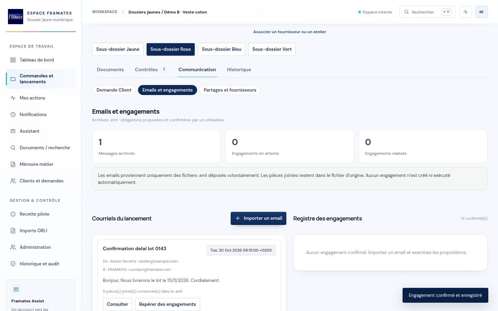

# FRAMATEX — Intelligence documentaire avancée

## État de livraison

Branche : `feat/document-intelligence`, basée sur `feat/smart-business-memory-ux`.

Cette branche livre deux améliorations ciblées à l’intake documentaire :

- lecture PDF hybride, page par page : texte natif conservé et OCR tenté sur les pages sans texte, avec provenance page/méthode/extrait, prétraitement d’image et tentative d’orientation Tesseract;
- comparaison d’une version avec sa version précédente pour les champs structurés persistés et les constats Excel, accessible depuis l’historique documentaire.

La comparaison n’effectue aucune fusion ni modification automatique. Elle est limitée aux résultats structurés déjà extraits et aux constats de formules Excel; ce n’est pas une comparaison sémantique complète du contenu de deux documents.

## Architecture, fichiers et API

Aucune table ni migration n’a été ajoutée. Les résultats sont adossés aux modèles d’analyse et aux inspections Excel déjà persistés. Fichiers modifiés :

- `app/intake.py` : OCR PDF page par page, prétraitement et provenance d’extraction;
- `app/intake_routes.py` : comparaison de version;
- `static/internal.js` : affichage du comparateur dans l’historique;
- `tests/test_intake.py` : tests ciblés de PDF hybride et comparaison/permission;
- `docs/DOCUMENT_INTELLIGENCE_PROGRESS.md`, ce rapport et les trois captures ci-dessous.

API ajoutée : `GET /api/document-versions/{version_id}/compare-previous`. Elle exige une session utilisateur ainsi que `launch.read` et `document.read` sur le sous-dossier du document. Elle compare seulement la version précédente immédiate du même document. L’intake OCR réutilise le parcours d’analyse existant et ses contrôles, limites de taille et permissions; aucune nouvelle route d’accès public n’est créée.

## État par exigence

- **Partiel — OCR/intégrité** : PDF hybride et provenance page/méthode/extrait améliorés. Image OCR existante préservée. Pas de vérification périodique SHA-256 ajoutée, ni de parcours complet pour signaler toutes les altérations externes. La correction de rotation est une tentative via OSD, sans garantie pour les documents inclinés. Les limites de pages/temps et le fallback si Tesseract manque restent en place.
- **Partiel — classification/extraction** : classification et extracteurs métier existants préservés. Cette branche ne généralise pas la prise en charge des 22 catégories, ne complète pas les champs demandés ni la provenance exhaustive feuille/cellule/version/confirmation.
- **Non livré — doublons intelligents** : aucun rapprochement similaire/visuel ou choix guidé de version indépendante/nouvelle version. Le mécanisme existant de doublons exacts reste inchangé.
- **Partiel — Excel/cohérence** : constats Excel existants apparaissent dans la comparaison; aucun moteur approfondi de références, caches non fiables ou nouvelles règles de cohérence n’a été ajouté.
- **Partiel — comparaison et impacts** : comparaison des champs structurés extraits et des constats Excel seulement. Pas de diff textuel complet, calcul d’impact métier, chaîne de revérification ou alertes dédupliquées persistantes.
- **Non livré — décisions et événements** : pas de workflow d’acceptation/justification d’anomalie, d’événements métier structurés ou de notification supplémentaire.
- **Non livré — recherche** : aucun index plein texte/FTS5.
- **Préparation IA** : aucun modèle, RAG ou chatbot installé, conformément au périmètre demandé.

## Validations exécutées

Les recettes ont été lancées sur le code de révision `096c5887e2e5df841dfe38cb38191462da49acf0` avec un arbre propre :

- Python : `188 passed, 1 warning` (dépréciation Starlette/httpx);
- JavaScript : `node --test tests/*.cjs`, 19 suites réussies;
- recette API/plateforme : `94/94`, dont migration sur copie existante, contrôle d’accès et stabilité runtime;
- recette Chromium complète : `133/133`, dont parcours client A/B, OCR, responsive (1440/1024/820/390 px) et stabilité runtime.

Les captures ci-dessous sont issues de la recette Chromium enregistrée dans `/workspace/artifacts/document-intelligence/browser/captures`.

### Écrans capturés




## Décisions, coordination et améliorations futures

Les analyses restent des propositions explicables, non une preuve de conformité; aucune donnée ou décision métier n’est écrite automatiquement. Le comparateur recommande de confirmer les valeurs à la source et conserve les anciennes versions. Aucun changement aux rôles généraux ni au périmètre d’accès confié à Claude Code (`feat/access-management`) n’a été effectué. Aucune fusion et aucune modification de `main`.

À poursuivre en priorité : contrôles d’intégrité récurrents configurables; classification/extraction avec provenance complète et confirmation; détection de doublons potentiels et gestion humaine des rapprochements; cohérence interdocuments et anomalies persistantes stables; impacts et révérification ciblée; événements structurés; recherche locale plein texte. Calibrer toute mesure de confiance avant d’en afficher une. Aucune migration de base n’a été nécessaire pour les deux fonctions livrées.

## Reprise Windows (PowerShell)

```powershell
git fetch origin
git switch feat/document-intelligence
if ($LASTEXITCODE -ne 0) { git switch --track origin/feat/document-intelligence }
git pull --ff-only origin feat/document-intelligence
.\scripts\start_windows.cmd
```

La révision de code couverte par les recettes est `096c5887e2e5df841dfe38cb38191462da49acf0`. La livraison documentaire et les captures sont publiées sur `feat/document-intelligence`; le SHA de publication vérifié est donné dans le compte rendu final.
