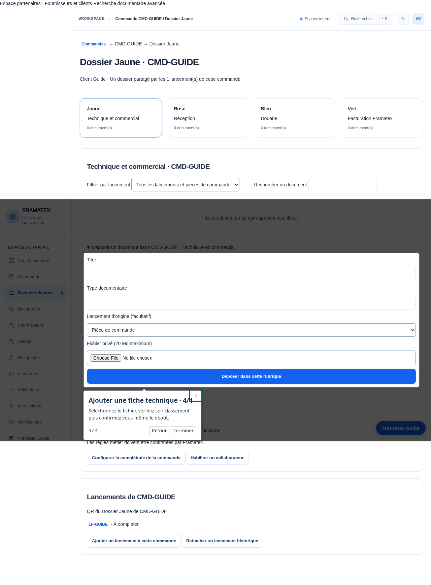
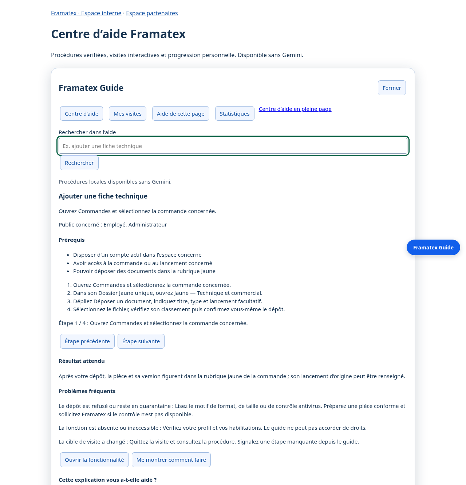

# Livraison Framatex Guide

Branche `feat/framat-user-guide`, issue de `main` au commit `d6cde69` après fusion de la PR #34. Livraison du 12 novembre 2026. Aucun déploiement, aucune fusion automatique et aucune modification des données de production.

## État Git et pull request

La branche est poussée sur `origin/feat/framat-user-guide`. `main` reste inchangée. La création automatique de PR a été tentée avec `gh pr create`, puis avec l’API REST : les deux requêtes POST à `api.github.com` ont reçu **`Forbidden`** dans cet environnement. Aucune PR créée ni exécution de CI distante n’est donc revendiquée.

Le titre proposé est **Framatex Guide : aide partagée, visites interactives et Gemini facultatif**. La description complète est conservée dans [PULL_REQUEST_GUIDE.md](PULL_REQUEST_GUIDE.md). [Créer la PR de la branche vers main](https://github.com/Rudolf-Staline/Framatex/pull/new/feat/framat-user-guide). Les tests et preuves de cette livraison ont été exécutés localement.

## Résultat

L’ancien assistant est remplacé par un composant partagé dans l’espace interne, la recherche et les portails. Le centre d’aide `/help`, les procédures et les visites fonctionnent sans Gemini. L’endpoint historique `/api/assistant/guide` délègue au même catalogue et conserve sa compatibilité.

Le catalogue contient **56 procédures françaises, 60 visites versionnées, 168 actions fermées et 43 contrats de cibles**. Le manuel est généré à partir de ces procédures. La migration additive `0024_user_guide` crée six tables d’apprentissage et de budget sans modifier les objets métier. Les visites ouvrent les écrans et présentent les formulaires ; chaque confirmation métier reste une action personnelle.

La recherche utilise d’abord les procédures autorisées. L’intégration facultative de Gemini, via le SDK officiel, sélectionne des identifiants parmi cinq candidats maximum. Le texte affiché et les actions proviennent toujours du catalogue. Ni les documents, ni le contexte métier brut, ni le texte brut de la question ne sont transmis. Les limites de requêtes, de durée et de consommation s’appliquent côté serveur.

## Couverture des critères demandés

| Critère | État et preuve |
|---|---|
| 1. Formation employé | Catalogue des fonctions principales et découverte filtrée ; parcours employé Chromium |
| 2. Visites fournisseur | Découverte et procédures propres ; transmission et reprise sur demande choisie testées sans envoi |
| 3. Visites client | Découverte et procédures propres ; choix d’une commande et questions testés sans créer de message |
| 4. Procédures administrateur | Droits, invitations, publication, configuration et ORLI ; refus vérifiés pour les autres profils |
| 5. Aide permanente | Bouton commun, panneau et `/help` avec lien permanent de procédure |
| 6. Questions sans Gemini | 122 questions locales évaluées ; absence de clé et panne simulée vérifiées |
| 7. Interprétation Gemini configuré | SDK et sélection structurée implémentés, fournisseur simulé testé ; disponibilité et gain réels à qualifier |
| 8. Raccourcis réels | Résolution serveur et registre fermé ; navigation critique vérifiée dans Chromium |
| 9. Visites multi-écrans | Application → recherche et aide pleine page → application, progression et reprise vérifiées |
| 10. Permissions | Droits employés, rubriques, ACL d’objet, organisations partenaires et changement de rôle testés |
| 11. Confidentialité Gemini | Payload limité au vocabulaire public et aux procédures ; tests d’exclusion de données sensibles |
| 12. Clé absente | Repli local testé, aucune dépendance de l’aide à une clé |
| 13. Dossier canonique | Procédures alignées sur une commande = un Dossier Jaune à quatre rubriques et plusieurs lancements |
| 14. Cibles contrôlées | Contrats de source et de routes en CI ; absence conditionnelle suspendue explicitement |
| 15. Parcours en CI | Workflow étendu, commandes exécutées localement ; résultat du runner GitHub à constater après création de PR |
| 16. Manuel | 56 procédures synchronisées, prérequis, étapes, résultats et problèmes ; approfondissements ci-dessous |
| 17. Fonctions réelles | Sources référencées ; limites ORLI, SMTP, extraction et règles métier signalées dans les procédures |

Cette matrice concerne uniquement Framatex Guide. Elle ne modifie pas le décompte historique des 273 exigences de la phase 3.

## Vérification observée

La suite complète Python a donné **138 réussites, un test réel Gemini ignoré et un avertissement de dépréciation SQLite**. Après les ajustements contextuels, le groupe ciblé Guide donne **18 réussites et un test réel ignoré** ; les deux contrôles migration/restauration passent également. Tous les tests JavaScript, le contrôle des ressources locales, les deux anciens parcours navigateur et le parcours Guide ont réussi. Les détails et commandes reproductibles figurent dans [FRAMATEX_GUIDE_TESTS.md](FRAMATEX_GUIDE_TESTS.md).

Le jeu de 122 questions obtient 100 % pour le choix attendu, les raccourcis principaux, la résolution sûre et les refus attendus. Ce résultat décrit un corpus synthétique fini ; il ne mesure pas toutes les formulations possibles. Les mesures et cas individuels sont conservés dans `artifacts/guide-evaluation.json`, les audits dans `artifacts/guide-browser.json`.

## Procédures à approfondir avec Framatex

Aucune des grandes catégories demandées n’est absente du catalogue. Les points suivants demandent une documentation métier plus précise, des exemples validés ou une recette sur les configurations réelles :

- `configure_completeness` et `approval_configuration` : exemples approuvés de profils, obligations, phases et circuits ; toutes les combinaisons de règles ne sont pas illustrées.
- `document_coherence`, `document_extraction` et `client_requirements` : exemples sur corpus Framatex, unités, justificatifs et limites OCR ; la précision industrielle n’est pas qualifiée.
- `orli_import` et `orli_resolution` : mappings des exports Framatex et cas d’arbitrage réels. Le guide décrit l’import contrôlé disponible, sans connexion ORLI directe.
- `invite_supplier`, `supplier_notifications` et `publish_client` : règles de diffusion et canaux approuvés par Framatex. L’envoi SMTP exige sa propre configuration et sa recette.

Les visites couvrent les entrées, panneaux et formulaires existants. Certains formulaires conditionnels doivent être ouverts par l’utilisateur ; la visite explique leur absence et permet de réessayer. Les captures et tests ne remplacent pas une recette manuelle de chacune des 60 visites dans tous ses états.

## Limites et exploitation

L’IA reste désactivée par défaut. Aucune clé réelle n’a été utilisée, aucun appel Google réel n’a été effectué et aucune amélioration de pertinence grâce à Gemini n’est revendiquée. La disponibilité du modèle demandé dépend du compte ; le nom est configurable. Le vocabulaire public envoyé au modèle peut perdre des nuances.

La version livrée est française. Les identifiants et la locale permettent d’ajouter l’anglais, mais cette traduction n’est pas fournie. Le fonctionnement « sans IA » exige toujours l’accès au serveur Framatex ; le manuel Markdown peut être lu hors connexion.

Les statistiques ne conservent pas les questions. Les événements, retours et compteurs sont des métadonnées personnelles minimales ; leur durée de conservation et un éventuel nettoyage périodique restent à fixer par l’exploitant. Les budgets ne constituent pas un plafond monétaire garanti. Les vérifications axe sur quatre tailles ne valent pas un audit WCAG complet.

Avant une installation décidée séparément : sauvegarder le répertoire de données et la base, arrêter les écritures, installer les dépendances, exécuter `python -m app.migrate upgrade`, puis démarrer l’application selon le guide de déploiement existant. Le retour complet à la version précédente utilise sa sauvegarde cohérente et son code. Ne pas supprimer des tables métier pour revenir en arrière. Aucune de ces opérations n’est exécutée sur un environnement publié pendant cette livraison.

## Documents livrés

- [Manuel utilisateur](../GUIDE_UTILISATEUR_FRAMATEX.md)
- [Architecture](FRAMATEX_GUIDE_ARCHITECTURE.md)
- [Catalogue et maintenance](FRAMATEX_GUIDE_CATALOG.md)
- [Configuration Gemini et confidentialité](FRAMATEX_GUIDE_GEMINI.md)
- [Tests et interprétation des mesures](FRAMATEX_GUIDE_TESTS.md)
- [Description de PR préparée](PULL_REQUEST_GUIDE.md)

## Captures de recette synthétique

