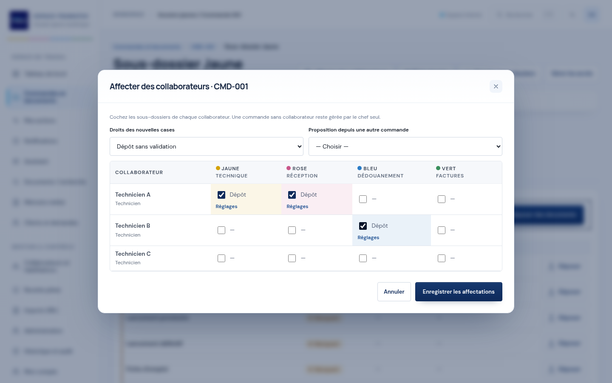
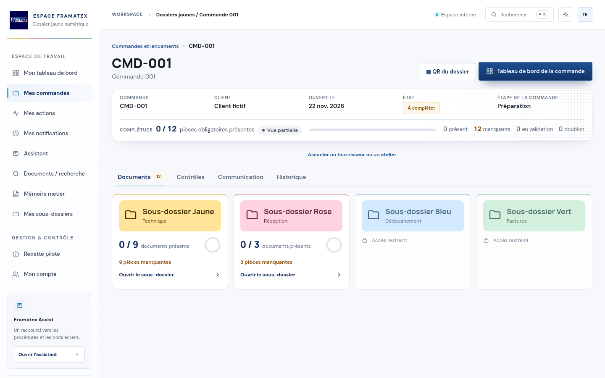
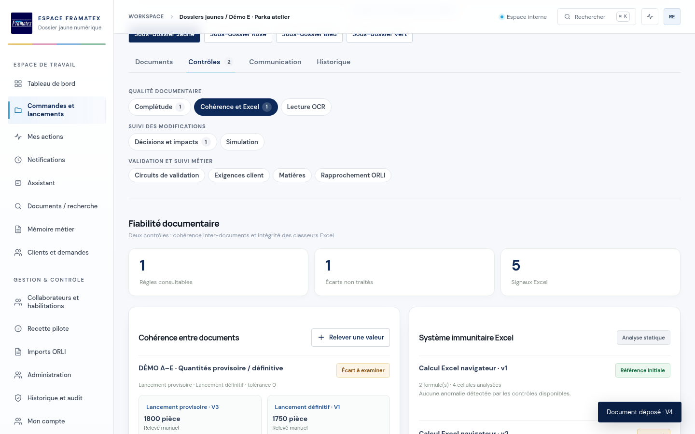
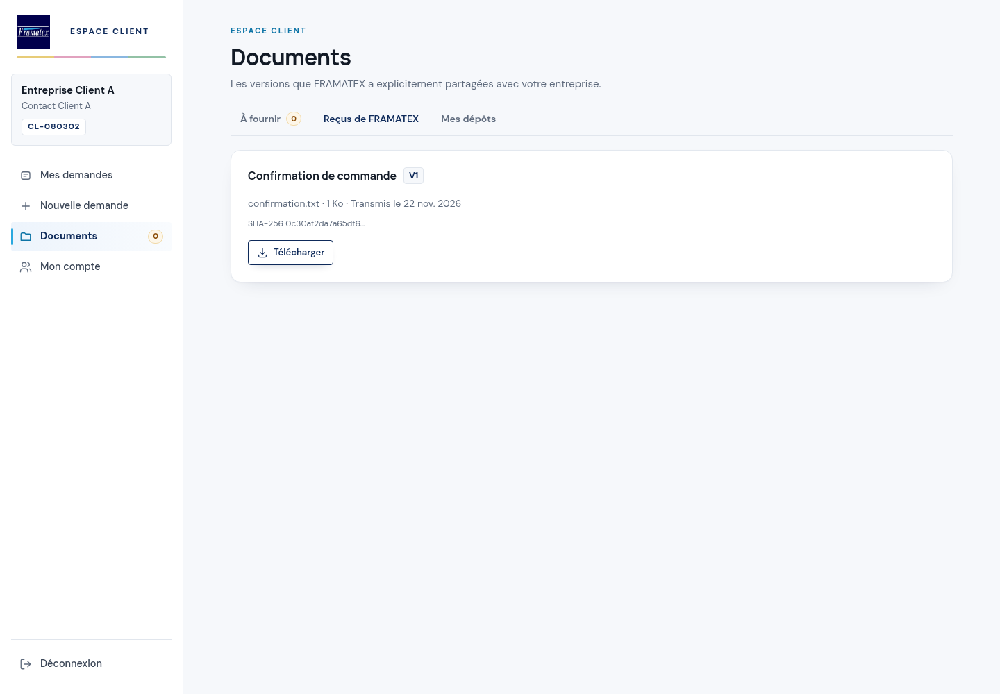
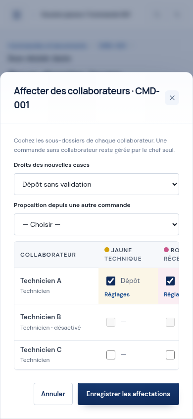

# FRAMATEX — Rapport d'intégration finale

## 1. Sources et méthode de fusion

| Élément | Révision |
|---|---|
| Base historique commune | `6b0eafe3713e16f607aadfb3a91724218f4467ca` |
| `feat/document-intelligence` | `fa34cf43f468da5021868e1ee8b7184b678a5024` |
| `feat/access-management` | `33aae76d3ad73aa55b3d985e28552309b0ed9f18` |
| Merge Git à deux parents | `a2771952a9f890f9b8e4c3c16329841fbfc3fddf` |
| Permissions documentaires intégrées, révision globalement testée | `89a398b2f97efba1d650429b5ecd0c9f037fc013` |
| Validateur Chromium des accès portable | `4ca6b1e304365f07d408c5e2c07ead0b7dae3bf8` |

La branche `integration/document-intelligence-access` a été créée depuis la tête documentaire, puis `feat/access-management` a été intégrée par `git merge --no-ff`. L'historique et les deux parents sont conservés. `main` n'a été ni modifiée ni fusionnée.

Deux conflits ont été résolus manuellement :

- `app/migrate.py` : imports des deux groupes de modèles et ordre `0012` → `0012b` → `0013`;
- `tests/test_business_memory.py` : fixture historique bornée explicitement avant `0011`, sans dépendre des migrations ajoutées ensuite.

## 2. Modèles et migrations conservés

- Intelligence documentaire : `DocumentRelationshipDecision`, analyses/identifications, champs confirmés, décisions de cohérence et index virtuel `document_content_fts`.
- Accès : `CollaboratorProfile`, `LaunchAssignment`, `LegacyAccessProposal`, préférences et audit des habilitations.
- Ordre effectif : `0012_document_intelligence`, `0012b_document_search`, `0013_access_management`.
- `0013` crée des propositions d'héritage à confirmer par le chef; elle n'accorde aucun accès implicite aux techniciens.

La recette a validé une base vierge, la migration d'une copie historique, le redémarrage, le rejeu idempotent et la conservation des données. Les bases et fichiers opérationnels n'ont pas été utilisés.

## 3. Fonctionnalités réunies

Le moteur documentaire conserve SHA-256, OCR PDF/image, provenance, classification des 22 exigences, extraction PDF/Word/Excel, quantités distinctes, doublons exacts/potentiels, versions guidées, comparaison, cohérence configurable, décisions humaines stables, alertes/revérification, notifications, audit et recherche FTS5. Il ne corrige ni ne décide automatiquement.

La gestion des accès conserve création/désactivation des collaborateurs, email unique, mot de passe temporaire, changement obligatoire, réinitialisation, affectations par commande et sous-dossier, actions individuelles, matrices, tableaux de bord, révocation immédiate, historique et préférences. Un nouveau technicien reste sans commande jusqu'à une affectation explicite.

L'Espace Client, la mémoire métier, les partenaires, les circuits, ORLI, QR/passeports et les interfaces existantes restent présents.

## 4. Adaptation des permissions documentaires

`app/access_control.py` reste le point de décision central. Le middleware détermine la commande même pour une URL indirecte de document, version, notification ou alerte. Le cache est recréé à chaque requête, donc une révocation s'applique à la requête suivante.

| Opération | Droits exigés |
|---|---|
| Lister une commande | affectation explicite + `launch.read` |
| Lire document, extraction ou passeport | `document.read` dans le sous-dossier |
| Télécharger | `document.read` + `document.download` |
| Déposer une nouvelle pièce | `document.write` |
| Ajouter une version, y compris dépôt guidé | `document.version` |
| Commenter | `document.comment` |
| Confirmer OCR ou valeur extraite | `value.write` |
| Voir doublons, comparaison, Excel, cohérence ou alertes | `controls.read` sur toutes les sources, en plus de `document.read` |
| Justifier un écart | `quality.review` sur toutes les sources |
| Traiter un impact | `impact.review` sur la cible, après visibilité complète des sources |
| Valider un document | `document.review`, distinct du dépôt |

La recherche FTS filtre d'abord les commandes affectées et les sous-dossiers lisibles. Elle ne restitue ni existence, titre, référence ni extrait d'une pièce interdite. QR, passeport et identifiant de version ne donnent aucun droit supplémentaire.

L'interface utilise les capacités renvoyées pour la commande courante (`can_download`, `can_version`, `can_comment`, `can_controls`, `can_value`, `can_quality`) plutôt que l'union globale des affectations. Les actions interdites ne sont donc pas proposées dans le dialogue documentaire.

## 5. Notifications

Les événements documentaires restent dédupliqués par leur clé et ciblés par commande/sous-dossier. Les destinataires doivent être actifs, affectés et disposer des droits nécessaires sur toutes les sources. Les préférences `internal`, `important_changes`, `validation_requests`, `reminders` et `new_assignments` sont appliquées avant création. Aucun email, SMTP ou service externe n'est déclenché.

## 6. Tests réellement exécutés

| Suite | Résultat final |
|---|---|
| Python complet | **207 réussis**, 1 avertissement Starlette/httpx, 0 échec |
| JavaScript complet | **19 réussis**, 0 échec |
| Permissions dynamiques ciblées | **13 réussis**, 0 échec |
| Sécurité documentaire Codex + Claude | **36 réussis**, 0 échec |
| Recette API, migrations et runtime | **96/96** |
| Recette Chromium globale | **135/135** |
| Recette Chromium accès, 3 techniciens | **15/15**, 12 captures |

La recette Chromium globale couvre Client A/B, demande, activation, correction V2, partage/retrait, FRAMATEX, dépôt, versions, doublon, OCR, Excel, cohérence, recherche, mémoire, audit, 1440/1024/820/390 px, erreurs JavaScript et runtime T+60.

Les scénarios ajoutés vérifient notamment : dépôt possible sans validation, dépôt sans création de version, `value.write` sans dépôt, lecture sans téléchargement, contrôles invisibles sans `controls.read`, alerte masquée, FTS confidentiel, accès direct refusé, révocation immédiate et persistance après redémarrage.

Résultats bruts locaux :

- `/workspace/artifacts/integration-final/qa/qa-results.json`;
- `/workspace/artifacts/integration-final/browser/demo-results.json`;
- `/workspace/artifacts/integration-final/access-ui/results.json`.

## 7. Tableau de validation

| Module | Intégré | Testé | Fonctionnel | Limites |
|---|---:|---:|---:|---|
| Landing et navigation responsive | Oui | Oui | Oui | Aucune régression observée |
| Espace Client et isolation A/B | Oui | Oui | Oui | Aucun envoi email |
| Comptes et mots de passe collaborateurs | Oui | Oui | Oui | Mot de passe temporaire transmis manuellement par le chef |
| Affectations commande/sous-dossier/action | Oui | Oui | Oui | Les propositions héritées exigent confirmation |
| Révocation et désactivation immédiates | Oui | Oui | Oui | Vérification à chaque nouvelle requête |
| SHA-256, OCR et extraction | Oui | Oui | Oui | OCR et analyse bornés en ressources |
| Classification et dépôt guidé | Oui | Oui | Oui | Proposition déterministe, décision humaine |
| Doublons et versions | Oui | Oui | Oui | Pas de similarité visuelle perceptuelle |
| Comparaison, Excel et cohérence | Oui | Oui | Oui | Règles configurées uniquement, aucun recalcul Excel |
| Décisions et revérification | Oui | Oui | Oui | Aucune décision automatique |
| Recherche FTS5 | Oui | Oui | Oui | Pas de backfill automatique de toutes les archives antérieures |
| Notifications internes ciblées | Oui | Oui | Oui | Pas de SMTP/Microsoft 365/n8n |
| Mémoire métier | Oui | Oui | Oui | Confidentialité liée aux affectations de commande |
| QR et passeports | Oui | Oui | Oui | Consultation toujours soumise aux droits |
| Migrations SQLite | Oui | Oui | Oui | Sauvegarde préalable toujours recommandée en exploitation |
| Lanceur Windows `.cmd` | Oui | Tests Python | Non validé sur Windows natif ici | Environnement d'exécution Linux |

## 8. Captures de la plateforme intégrée











## 9. Fichiers d'intégration principaux

- Accès : `app/access_control.py`, `app/access.py`, `app/access_models.py`, `app/access_migration.py`, `app/access_admin_routes.py`, `app/access_notifications.py`.
- Documentaire adapté : `app/document_intake_routes.py`, `app/document_relationships.py`, `app/intake_routes.py`, `app/quality_routes.py`, `app/duplicates.py`, `app/workflow_routes.py`, `app/internal_routes.py`.
- Notifications et migration : `app/internal_notifications.py`, `app/main.py`, `app/migrate.py`.
- Interface : `static/access-admin.js`, `static/app.js`, `static/internal.js`, `static/intake.js`, `static/brand/access.css`.
- Validation : `tests/test_access_management.py`, `tests/test_internal_frontend.cjs`, `scripts/validate_access_ui.py`.

## 10. Bugs et limites connus

Aucun défaut critique n'est resté ouvert après les recettes. L'avertissement Python restant est la dépréciation Starlette/httpx du client de test. Les limites documentaires déjà déclarées restent : pas de contrôle SHA périodique, pas de comparaison visuelle perceptuelle, analyse OCR bornée et pas de backfill FTS automatique des archives.

Le lanceur Windows existe et ses chemins/comportements sont couverts par la suite Python, mais il n'a pas été exécuté sous Windows natif dans cet environnement Linux. Le démarrage Uvicorn, les migrations, le redémarrage et Chromium ont été réellement exécutés.

## 11. Récupération Windows

```powershell
git fetch origin refs/heads/integration/document-intelligence-access:refs/remotes/origin/integration/document-intelligence-access

git show-ref --verify --quiet refs/heads/integration/document-intelligence-access
if ($LASTEXITCODE -eq 0) {
    git switch integration/document-intelligence-access
    git merge --ff-only origin/integration/document-intelligence-access
} else {
    git switch -c integration/document-intelligence-access refs/remotes/origin/integration/document-intelligence-access
}

git rev-parse HEAD
.\scripts\start_windows.cmd
```

Branche distante : `integration/document-intelligence-access`. Le SHA de publication final du commit contenant ce rapport est vérifié sur GitHub et communiqué dans le compte rendu final.
